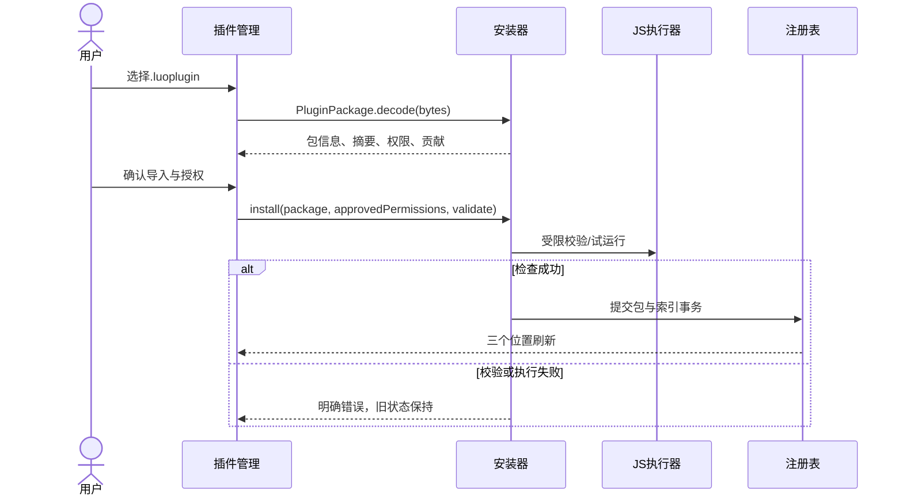

# Luotopia 插件 SPI v1 接口设计

状态：2026-11-21实现契约，按当前App与独立SDK对齐；不是全部验收完成的声明。外部JavaScript执行目前仅开放Android，其余平台保留原内置功能和插件管理，外部导入/执行返回 `UNSUPPORTED_RUNTIME`。真机、资源故障、发行包导入和视觉检查仍按第9节逐项取证。需求与默认模块清单见[系统插件重构设计](../superpowers/specs/2026-11-21-system-plugin-design.md)。

## 1. 契约边界

统一三个贡献位置：`navigation`、`campusCard`、`settingsRow`。内置原生插件与外部JavaScript插件共享身份、贡献、管理状态和错误语义；原生插件内部可复用原Flutter Widget，外部包只能通过JSON协议与宿主能力通信。

宿主启动时注册受信内置目录，读取已经验证的外部包索引，按用户配置生成三个入口集合。外部插件按需激活，不在启动时无条件执行所有包。导入后更新注册表和界面，不重编译App。

“注册了导航项”不等于“插件业务运行成功”：发现、校验、启用、渲染、交互是独立阶段，分别报告失败。

## 2. 包格式与 manifest

文件扩展名 `.luoplugin`，内容为ZIP，UTF-8文本。首版只允许以下文件：

```text
study-time.luoplugin
├─ manifest.json
├─ main.js                 # 自包含JavaScript，导出约定全局对象
└─ LICENSE.txt             # 作者提供的许可说明
```

图标先使用宿主公开的图标名，不加载外部字体、HTML、SVG或原生库；脚本可由作者自己的构建工具提前打包，但App不执行npm安装，也不下载运行时模块。只接受源码，不接收与引擎版本绑定的JS字节码。

```json
{
  "schemaVersion": 1,
  "id": "org.example.study-time",
  "name": "学习时长统计",
  "version": "1.0.0",
  "apiVersion": 1,
  "entry": "main.js",
  "description": "统计输入的学习时长",
  "author": "示例作者",
  "license": "MIT",
  "permissions": ["storage.self"],
  "networkHosts": [],
  "views": ["main", "preferences"],
  "contributions": [
    {"id":"tab", "slot":"navigation", "title":"学习统计", "icon":"timer", "viewId":"main", "allowedViews":["main"]},
    {"id":"card", "slot":"campusCard", "title":"学习统计", "icon":"timer", "viewId":"main", "allowedViews":["main"], "size":"small", "color":"sky"},
    {"id":"settings", "slot":"settingsRow", "title":"学习统计设置", "icon":"tune", "viewId":"preferences", "allowedViews":["preferences"], "group":"extensions"}
  ],
  "config": [
    {"key":"targetMinutes", "type":"number", "label":"目标分钟数", "default":120, "min":1, "max":1440}
  ]
}
```

约定：

- `id` 为小写反向域名形式，最长96字符，符合 `^[a-z][a-z0-9]*(?:[.-][a-z0-9]+)+$`；禁止 `luotopia.` 保留前缀。显示名与作者不是身份凭据。
- 贡献ID与viewId符合 `^[a-z][a-z0-9_-]{0,47}$`。唯一键由宿主计算为 `pluginId/contributionId`，包不能指定别的插件的键。
- 首版 `schemaVersion=1`、`apiVersion=1` 必须精确匹配；未知能力或节点类型明确拒绝，不猜测执行。
- `version` 使用发布版 `major.minor.patch` 三个非负整数，字符串最长32字符，不接受前导零/预发布标识；更新必须更高版本。此规则服务于首版明确版本比较，不冒充完整SemVer解析器。
- `entry` 固定 `main.js`。不可包含路径穿越、绝对路径、盘符、反斜杠、符号链接或重复/大小写等价条目。
- 首版包必须恰好有这3个文件，压缩包最多5MiB，解压总量最多10MiB，manifest最多64KiB，脚本最多2MiB，LICENSE.txt最多1MiB；脚本/许可不能仅有空白或BOM。解压时按实际流量计数，不信任ZIP声称的大小；manifest拒绝重复JSON键。活动包、保留包元信息、活动数据与封存数据按pluginId去重后合计最多16个命名空间，卸载保留数据仍占名额；整个插件状态文件最多64MiB。可在插件管理“待重新导入”行永久删除不再需要的保留数据释放名额。
- 外部包不能提供 `core`、`nativeBuilder`、`route`、`protected` 等宿主字段；外部贡献只指向本包声明的viewId。
- 每个贡献必须声明 `allowedViews`，包含自己的根viewId且只能引用包内views。子页面导航继承当前贡献身份；共享页面必须被多个贡献分别显式允许，隐藏其中一个入口不关闭另一个合法共享入口。
- `group` 外部只允许 `extensions`；内置设置组由宿主定义。卡片 `size` 仅 `small`/`wide`；新增贡献默认值由安装预览确认。
- views为1..32项，单包贡献为1..32项，每个allowedViews最多32项，config最多32项，networkHosts最多16项；各ID列表不得重复。
- name/author/license为1..128个UTF-16代码单元，description为1..2000，贡献title为1..64；配置label、选项value/label为1..128。Dart/JavaScript以UTF-16计数，SDK的Python工具采用相同规则。
- 公开图标：`timer,tune,home,list,forum,school,settings,book,calendar,star,code,cloud,chart,info`；颜色：`sky,blue,green,amber,purple,pink,slate`。可选size/color/group缺省或null使用默认值。
- 配置字段支持 `text`、`number`、`boolean`、`choice`，共同字段为key/type/label/default。key符合 `^[a-zA-Z][a-zA-Z0-9_]{0,47}$` 且唯一。text须有1..4096的maxLength（default允许空串）；number须有有限min/max且default在闭区间内；boolean的default必须为布尔值；choice须有1..100个 `{value,label}` 选项、value唯一且default属于其中。v1不支持秘密配置字段，不让插件把Token写入普通偏好或备份。
- `networkHosts` 只有声明 `network.https` 才有效，使用规范小写的精确DNS主机名，不接受通配符/IP/URL/端口/尾点；整名最多253字符，每段1..63字符，当前顶级域名只接受2..63个英文字母。

## 3. 外部 provider 方法

`main.js` 定义一个对象 `globalThis.luotopiaPlugin`。不使用反射寻找任意函数名，不执行包自带的初始化Shell命令。

```typescript
type Json = null | boolean | number | string | Json[] | { [key: string]: Json };

interface PluginContext {
  pluginId: string;                // 宿主绑定，插件不能变更身份
  contributionId: string;          // 当前入口的局部ID
  viewId: string;
  locale: "zh" | "en";
  theme: "light" | "dark";
  config: { [key: string]: Json };  // 宿主按schema校验后的配置
  host: HostApi;
}

interface RenderRequest {
  state: Json;                    // 当前view实例内状态，初始null
}

interface ActionRequest {
  actionId: string;                // 来自最后一次有效view中的按钮
  input: { [fieldId: string]: Json }; // 当前表单已校验输入
  state: Json;
}

interface PluginResult {
  state: Json;                    // 新view状态，仅接受JSON兼容值
  view: PluginView;
}

interface LuotopiaPlugin {
  apiVersion: 1;
  activate?(context: PluginContext): void | Promise<void>;
  render(request: RenderRequest, context: PluginContext): PluginResult | Promise<PluginResult>;
  onAction(request: ActionRequest, context: PluginContext): PluginResult | Promise<PluginResult>;
  deactivate?(): void | Promise<void>;
}
```

- `activate`：每个PluginSession/view引擎首次打开时调用一次，允许读自己的存储；不可在此产生网络、写入、弹窗等副作用。安装试运行在独立引擎调用一次activate并检查各贡献根view，不等同于正式激活。
- `render`：只读地生成当前声明view，允许读插件自己的数据；禁止网络请求、存储写入和导航。界面不应在每次Flutter build时重复执行脚本，只在进入/显式刷新/配置变更时发起。
- `onAction`：由明确用户操作触发，可以使用已授权能力；返回新状态和完整新view。宿主重新验证输入、actionId、插件状态和授权，不能信任脚本传来的身份。
- `deactivate`：尽力清理；有独立清理时限，不能依赖插件配合才真正关闭引擎。进程退出不保证调用，应使用host.storage主动保存需要保留的业务状态。
- 同一view实例串行处理动作并防重复提交；引擎使用宿主请求序号，PluginSession对象绑定贡献身份与generation，不向插件开放自报身份的参数。卸载、停用或更新后旧generation的结果一律丢弃，不能写回新实例。
- 一包多个入口可以有多个view实例，state按instance隔离；共享信息只通过该插件自己的storage交换。渲染器产生的输入不包含其他表单或账户字段。
- 初始化、调用或Promise异常被转换为统一错误，不把堆栈和用户输入直接展示给普通用户。

## 4. 原生界面协议

宿主为导航、卡片、设置行绘制外层外观。外部脚本只描述内容与交互，不提供任意CSS、Flutter构造器或HTML。

```typescript
interface PluginView {
  title: string;
  nodes: ViewNode[];
}

type ViewNode =
  | {type:"text"; id:string; text:string; tone?:"normal"|"muted"|"error"}
  | {type:"input"; id:string; label:string; value:string; maxLength:number; multiline?:boolean}
  | {type:"number"; id:string; label:string; value:number; min:number; max:number}
  | {type:"toggle"; id:string; label:string; value:boolean}
  | {type:"select"; id:string; label:string; value:string; options:{value:string;label:string}[]}
  | {type:"button"; id:string; label:string; actionId:string; style?:"primary"|"secondary"}
  | {type:"list"; id:string; items:{id:string;title:string;subtitle?:string}[]};
```

view由宿主用现有设置/卡片/表单组件渲染，颜色引用宿主主题。校园卡片本身的封面使用manifest与用户覆盖；短按后打开插件view，避免每个列表卡片都运行脚本或抢占手势。原内置天气卡例外，继续使用原生实时组件。

每个view最多100个节点，list最多200行；总返回JSON不超过256KiB，深度不超过16；所有数值有限，所有节点ID唯一，列表行ID在本列表内唯一，字段和动作ID不得为空。拒绝未知字段/节点、函数、循环对象、BigInt、NaN、Infinity、带自定义原型或toJSON的结果。input的maxLength必须为1..4096个UTF-16代码单元，表单总量64KiB，当前view所有表单字段必须完整提供，不能夹带其他字段。超限输入应提示，不能截断业务输入后静默执行。

`state`仅限JSON且不超过64KiB，不允许脚本注入Widget引用。v1不支持递归任意组件树、任意布局脚本或自定义手势。

view.title为1..128个UTF-16代码单元，节点/动作/列表行ID为1..128；text与列表title/subtitle最多4096，表单/按钮label为1..128，select选项为1..100项且value唯一，选项value/label为1..128。number的min/max/value须为有限数且value在闭区间内；toggle的value必须为布尔值，select的value必须属于options。宿主保存校验后的不可变快照，不能在解析后通过原始Map/List改变已校验界面。

## 5. 宿主能力 HostApi

```typescript
interface HostApi {
  storage: {
    get(key: string): Promise<Json>;
    set(key: string, value: Json): Promise<void>;
    remove(key: string): Promise<void>;
  };
  http: {
    request(request: {
      url: string;
      method: "GET" | "POST";
      headers?: { [key: string]: string };
      body?: string;
    }): Promise<{status:number; headers:{[key:string]:string}; body:string}>;
  };
  openView(viewId: string): Promise<void>;
  log(level: "debug" | "info" | "warn" | "error", message: string): void;
}
```

| 方法 | 权限/规则 | 失败 |
| --- | --- | --- |
| `storage.get` | `storage.self`；本插件命名空间；不存在返回null | 越权/键非法/读取失败 |
| `storage.set/remove` | `storage.self`；仅用户动作阶段；每插件最多1MiB；原子写入 | 超额/保存失败；原值保留 |
| `http.request` | `network.https`；仅用户动作阶段；精确域名授权 | 拒绝域名/超时/取消/响应超限 |
| `openView` | 仅用户动作阶段；继承当前贡献，只进入其allowedViews | view不属于当前贡献/贡献隐藏/插件已停用 |
| `log` | 当前桥接保留方法但直接丢弃插件提供的日志内容，不转交应用日志 | 无日志交付保证 |

额外约定：

- 存储key只允许 `[a-zA-Z0-9._-]`，1—128字符；不是文件路径；宿主通过活动插件绑定命名空间，不接受请求里自报pluginId。
- HTTP默认10秒、最多3次重定向、响应最多1MiB、请求体最多256KiB。HTTPS只允许443端口；不接受用户信息字段、任意Host/Cookie/Authorization头、代理参数或调用者提供的IP地址。
- 解析目标主机所有IP并拒绝非公网地址，连接使用已校验地址且TLS仍核对原主机，避免DNS重绑定；每个重定向重做域名/地址/权限检查。返回头过滤Set-Cookie等凭据数据。
- 不复用应用带登录态的HTTP客户端或WebView Cookie，不暴露未受控fetch/XMLHttpRequest/网络模块；网络只经host.http。
- 停用/超时/销毁view时取消其在途请求；完成回调再次验证generation，防止取消后结果写回。
- 宿主资源另设上限：每请求最多32次能力调用，其中HTTP最多4次；每插件HTTP最多2个并发、全局最多8个；待处理桥接请求每插件最多16个、全局最多64个。超过上限立即返回 `RESOURCE_LIMIT_EXCEEDED`，不无限排队。每动作累计网络收发最多2MiB，单插件所有在途网络缓冲最多4MiB，全局最多16MiB；按流式实际字节计费，在读取完整响应前执行限额。
- 同时最多4个外部引擎，每插件最多3个view实例，每引擎一次只执行一个请求。当前达到上限即拒绝新激活并提示关闭一个插件，不自动驱逐实例或丢弃输入。总额度覆盖所有插件，不只依赖每引擎32MiB。
- 配额按宿主持有的pluginId/requestId计数，不能由脚本重置；请求完成、取消或异常必须释放缓冲、并发名额和句柄。上限是首版默认值，真实设备校准时同步更新测试与文档。
- v1不提供应用账户、教务Cookie、AI密钥、完整数据库、文件系统、任意URL跳转、共享事项写入等能力。以后若要新增，须单独定义最小数据模型、授权和兼容策略，不通过通用“执行命令”绕过契约。

## 6. 宿主侧 Dart SPI 与管理方法

当前实现没有 `PluginProvider` 抽象类、`ImportApproval` 或 `ImportPreview` 数据类。内置功能由 `domain/builtin_plugins.dart` 的 `BuiltinPlugin` 受信目录及 `PluginContribution` 引用原路由/原生组件；外部provider对象由 `runtime/PluginSession` 调用。以下列出实际公开签名，省略方法体：

```dart
// data/plugin_package.dart
factory PluginPackage.decode(List<int> bytes);

// application/plugin_manager.dart — PluginManager
Future<void> load();
List<PluginSummary> list();
PluginSummary details(String id);
PluginContribution contribution(String key);
List<PluginContribution> entries(ContributionSlot slot);
bool isVisible(String key);
Map<String, dynamic> configuration(String id);
int generation(String id);
void checkAccess(String key, String viewId, [int? expectedGeneration]);
Future<void> install(PluginPackage package, {
  required Set<String> approvedPermissions,
  required Future<void> Function(PluginPackage) validate,
  bool reuseData = false,
  bool update = false,
});
Future<void> setEnabled(String id, bool enabled);
Future<void> uninstall(String id, {bool deleteData = false});
Future<void> forgetRetainedData(String id);
Future<void> restoreBuiltin(String id);
Future<void> setContributionVisible(String key, bool visible);
Future<void> updatePresentation(String key, Map<String, dynamic> patch);
Future<void> updateConfig(String id, Map<String, dynamic> config);
Future<void> reorder(ContributionSlot slot, List<String> keys, {
  int? expectedRevision,
});
Future<void> restoreDefaultLayout();
Map<String, dynamic> exportBackup();
static void validateBackup(Map<String, dynamic> backup);
Future<void> restoreBackup(Map<String, dynamic> backup);
Future<void> restoreBackupWithDatabase(Map<String, dynamic> backup,
  Future<void> Function(Future<void> Function() writePlugins) transaction);

// runtime/plugin_session.dart — PluginSession
Future<PluginResult> open();
Future<PluginResult> render();
Future<PluginResult> action(String id, Map<String, dynamic> input);
void dispose();
static Future<void> validatePackage(PluginPackage package);
```

导入预览直接使用 `PluginPackage.decode` 的结果（manifest、script、license、SHA-256 digest），管理页保留该对象并展示权限/贡献/摘要；确认后把同一对象、明确授权集合和 `PluginSession.validatePackage` 传给install。更新使用同一方法的 `update:true`，没有独立update方法。install记录试运行前revision，提交时再次核对；试运行失败或revision改变不覆盖活动状态。管理层供受信宿主调用，外部JS不能提供自己的validate回调或直接调用管理API。

实际数据类型为PluginSummary、PluginManifest、PluginContribution、PluginView/PluginResult等；source和protected由内置目录/安装路径赋值。JSON边界使用Map/List并由解析器完整校验及快照冻结，不能据Map类型推断数据已经可信。

公开SDK位于 `src/plugin/luotopia-plugin-sdk/`（README、index.d.ts、Python标准库pack.py和测试），独立学习统计示例位于 `src/samples/plugins/study-time/`。App实现位于 `lib/features/plugins/{domain,data,application,presentation,runtime}/`；QuickJS绑定的1.5.1仓库补丁位于 `src/plugin/flutter_qjs_next/`，通过path依赖装配。外部作者只拿SDK和自己的三个载荷文件即可打包，不导入宿主私有Dart包。

### 方法的关键保证

- 变更方法串行复制当前状态、校验并持久化，成功后才发布到内存；核心管理操作由manager拒绝。reorder可传expectedRevision；install自动捕获并核对revision。
- `reorder`必须提供该slot当前有效且可见的完整ID排列，拒绝重复、遗漏、未知ID；导航三个核心锚点不能移动。设置仅允许同组可选行排序，核心行位置固定；外部设置使用单独扩展组。读取/恢复布局也按核心位置和分组归一，不能用备份越过此规则。
- `updatePresentation`只合并title/icon/color，不能修改id、source、protected、route或viewId；当前不接受null单字段恢复，恢复默认布局清除覆盖值。
- `setEnabled(false)`拒绝核心，解除全部贡献并终止执行；设置可选入口隐藏仅影响该贡献的公共入口，原必要共享服务仍在。
- `restoreBuiltin`只针对内置可选目录；外部插件不能伪装调用它。
- `uninstall`拒绝核心；内置可选插件转成停用，外部插件从活动索引移除。默认封存本插件数据和包元信息；deleteData只删除本插件数据。`restoreDefaultLayout`恢复内置项、清除覆盖/顺序，隐藏所有外部贡献但保留包与数据，外部停用状态不被自动授权恢复。
- `forgetRetainedData(id)`清除该ID的封存数据、保留包元信息与待恢复配置；未安装时也清除其旧配置，使不再占用命名空间名额。它不删除其他插件，不能以此清理仍安装插件的活动数据。
- 更新试运行限制副作用；v1更新不支持任意插件数据迁移钩子，配置变更只接受兼容新增可选字段，破坏性schema变更明确拒绝并说明。这样失败可真正保留旧数据，不能用仅替换包文件冒充完整回滚。

备份服务导出格式为v4，兼容读取v3；v4新增插件schema=1的备份区，包含包ID/name/version/digest、布局/非敏感配置及业务数据，不包含脚本或运行权限。导入确认提前告知替换语义：成功恢复时，对备份包元信息或数据涉及的ID，撤下已安装的同ID外部包及其执行权限、活动数据与配置，封存备份数据；未出现在备份中的外部插件保留。受影响的旧session随generation失效，缺包列为待重新导入。同ID重新导入可使用原版本，因旧活动包已撤下而走安装路径；仍须重新授权并明确确认reuseData，摘要变化单独提示。这样不会被旧installed状态阻挡，也不需要先卸载而覆盖刚封存的数据。

单插件数据1MiB，活动与保留命名空间合计最多16个，布局1MiB、整个插件备份18MiB；恢复合并后也检查总容量。SQLite导入通过restoreBackupWithDatabase协调：在SQLite导入行校验通过后、事务commit前写插件快照，commit成功后才发布manager内存状态；捕获数据库失败时补偿恢复旧插件快照，补偿失败会阻止继续覆盖并提示恢复。真实断电/进程中断恢复仍须单独验收，不能把补偿当作跨文件数据库原子提交证明。

## 7. 生命周期、路由与失败



实际持久化区分已安装/停用，隐藏是贡献级状态；未安装不在活动目录，试运行未通过不暴露贡献。执行失败在当前session显示错误，超时等终止引擎；当前没有持久化 `installed.faulted` 状态枚举，不能把管理页仍显示已启用误当作引擎仍在运行。

每次进入入口依次验证：安装→启用→贡献可见→view属于该贡献allowedViews→权限→执行。外部页面统一路由，禁止通过旧链接或伪造贡献/view组合绕过隐藏、停用或卸载。`openView`不能修改当前贡献身份；切换贡献必须由宿主合法入口触发。内部受信业务链接若使用同一功能，必须显式登记它是公开入口还是核心内部服务，不能靠未登记路由绕过规则。

实际Dart错误类型为 `PluginException(code,message)`，普通UI显示可读说明，不传原始堆栈。插件调用宿主能力时，桥接Promise以 `Error` 拒绝，`error.message` 是错误码；不提供phase、retryable或requestId字段：

```typescript
type PluginError = Error;
```

| 错误码 | 行为 |
| --- | --- |
| `INVALID_PACKAGE` / `PACKAGE_LIMIT_EXCEEDED` | 拒绝导入，清理本次暂存，不动现有包 |
| `RESERVED_ID` / `DUPLICATE_CONTRIBUTION` | 拒绝注册 |
| `UNSUPPORTED_API` / `UNSUPPORTED_RUNTIME` | 不执行；明确宿主版本/平台限制 |
| `CORE_PLUGIN_LOCKED` | 拒绝管理操作 |
| `PLUGIN_DISABLED` / `PLUGIN_NOT_FOUND` / `CONTRIBUTION_HIDDEN` | 显示不可用并提供返回管理或主页 |
| `PERMISSION_DENIED` | 拒绝能力调用，不返回部分敏感数据 |
| `INVALID_INPUT` | 表单或脚本输入错误，保留用户输入供修正 |
| `SCRIPT_ERROR` | 当前操作失败；保留最后有效界面和可返回入口 |
| `EXECUTION_TIMEOUT` / `MEMORY_LIMIT_EXCEEDED` / `INVALID_VIEW` | 关闭失败的执行实例/显示局部错误；不自动无限重试，实际资源释放与其他功能可用性须由故障测试验证 |
| `NETWORK_ERROR` | 当前动作失败，允许用户重试，无自动无限重试 |
| `RESOURCE_LIMIT_EXCEEDED` | 拒绝超额能力调用/激活，释放本次申请，不拖累其他插件 |
| `PERSISTENCE_FAILED` / `REVISION_CONFLICT` | 不报保存成功；保留旧状态或重新读取后提示 |
| `UPDATE_FAILED` | 保留旧版本、配置与数据 |

当前后端为仓库补丁版QuickJS绑定1.5.1：每次native调用100ms中断窗口、每请求累计JS工作500ms、含异步等待总15秒；每引擎内存32MiB、栈1MiB。调用、Promise微任务及结果序列化都在预算内，工作在独立Dart isolate。空闲session关闭时对deactivate尽力给100ms，正在执行时直接停止；补丁使native关闭不再执行pending jobs。worker在native dispose完成后才回报closed，宿主只在确认释放后归还引擎名额；1秒看门狗未收到确认则强制结束isolate并隔离保留该容量，提示重启，而不是仅凭Isolate.kill宣称native堆已释放。当前外部后端只开放Android，其他平台报告UNSUPPORTED_RUNTIME。上述上限仍需真机死循环/无限微任务/巨大getter/分配及资源释放校准，不在本文登记通过。

## 8. 最小行为示例

下面示例说明协议行为，不依赖宿主私有业务类。使用第2节manifest时，`preferences`也有明确结果。

```javascript
globalThis.luotopiaPlugin = {
  apiVersion: 1,
  render(request, context) {
    if (context.viewId === 'preferences') {
      return {state: null, view: {title: '学习统计设置', nodes: [
        {type: 'text', id: 'target', text: '目标：' + context.config.targetMinutes + ' 分钟'},
        {type: 'text', id: 'hint', text: '在插件管理的配置中修改目标。'}
      ]}};
    }
    if (context.viewId !== 'main') throw new Error('INVALID_INPUT');
    return this.makeView('', '请输入用逗号分隔的分钟数，例如30,45');
  },
  onAction(request, context) {
    if (context.viewId !== 'main' || request.actionId !== 'sum') {
      throw new Error('INVALID_INPUT');
    }
    const raw = request.input.minutes;
    if (typeof raw !== 'string' || raw.length > 500) {
      return this.makeView(typeof raw === 'string' ? raw : '', '每项必须是0到1440的整数，最多100项、500字符。');
    }
    const parts = raw.split(',').map(value => value.trim());
    const valid = parts.length <= 100 && parts.every(value => /^\d{1,4}$/.test(value));
    const values = parts.map(Number);
    if (!valid || values.some(value => value > 1440)) {
      return this.makeView(raw, '每项必须是0到1440的整数，最多100项。');
    }
    const total = values.reduce((sum, value) => sum + value, 0);
    return this.makeView(raw, '合计 ' + total + ' 分钟；目标 ' + context.config.targetMinutes + ' 分钟');
  },
  makeView(value, message) {
    return {state: null, view: {title: '学习时长统计', nodes: [
      {type: 'input', id: 'minutes', label: '分钟数', value, maxLength: 500},
      {type: 'button', id: 'calculate', label: '计算', actionId: 'sum'},
      {type: 'text', id: 'result', text: message}
    ]}};
  }
};
```

宿主必须按对象方法绑定this调用provider方法（或由SDK包装保留绑定）；不得使用未转义的字符串拼接把input塞进JS源码。只通过引擎函数调用与JSON数据桥传参。

独立作者将三个载荷文件放入干净暂存目录，以SDK的 `python pack.py <目录> <新包.luoplugin>` 预检并生成ZIP，无需拿到App源码或安装Flutter。工具只使用Python标准库，index.d.ts提供公开类型；源目录中的README/测试不得一起入包，已有产物不覆盖。打包完成不等于Android宿主执行验收通过。

## 9. 契约测试矩阵

- 同一安装包前后摘要一致；新包导入后三个贡献立即可用，输入30,45得到75，输入空项/负数/超大值得到错误反馈。
- 只改显示名和图标，pluginId/contributionId/viewId及原路由不变。
- 只隐藏card，tab和settings仍可用；停用包后全部拒绝，旧页面、在途请求与旧generation结果不能继续提交。
- 隐藏settings后其旧链接被拒绝；伪造tab/preferences被拒绝；tab/main和card/main共享页面仅在各自入口可见时可用。
- v1未知字段中的宿主专属能力、未知API、未声明view/action、越权存储和外部网络直接调用均被拒绝。
- 核心锁定、默认页回退、论坛/AI旧配置迁移、顺序持久化、恢复默认、备份后缺包恢复。
- 更新失败保留旧版本；新增权限必须重新确认；卸载默认保留数据；清除插件数据不影响课程/账户/事项。
- 备份包含host.storage的命名空间数据，缺包恢复后先封存；匹配包重新导入并经用户确认复用数据后，原统计数据恢复，其他ID不能读取。
- 同步死循环、无限微任务、巨大对象序列化、内存分配、网络超时分别验证真实停止与资源释放，不能只看到界面弹出“超时”。
- 快速发起大量宿主调用、连续激活多个插件、关闭仍有请求的页面，验证插件级和全局配额、取消及核心响应。
- 设置、校园、导航使用既有主题与组件的视觉回归，以及真实Android发行模式下的脚本运行检查。

所有“通过”必须来自实际执行。本实现契约保留完整验收要求，不以源码存在、单元测试或文档更新替代发行包、真实设备、视觉和资源释放证据；具体结果应记录在对应验证报告，本文不登记未经执行的成功状态。
