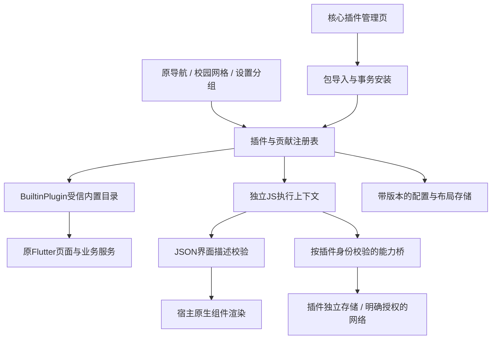

# Luotopia 系统插件重构需求与设计

日期：2026-11-21。状态：已批准需求的实现契约，按当前App/SDK澄清实现边界；不代表下列验收标准已经全部通过。

本次在原有 Flutter App 上建立统一插件机制，将底部导航模块、校园卡片、设置功能行改为插件贡献的入口。保留现有业务、主题、图标、玻璃卡片、背景与动画；允许用户导入外部插件文件后直接运行，不重新打包 App。

配套接口：[SPI v1](../../plugins/SPI-v1.md)。两份文档共同构成实现与验收依据。此前 README 与 DESIGN.docx 中的“课表 CSV 单扩展、重新打包接入”属于旧课程方案，其他提交材料须同步协调，不能混称已经实现。当前外部JavaScript执行仅开放Android；其他平台保留原内置功能与插件管理，导入执行报告UNSUPPORTED_RUNTIME，不能据代码可构建宣称外部运行兼容。

## 1. 已确认要求与设计选择

### 用户明确要求

- 可以进行较大内部重构，但原有核心功能与美术不变。
- 三个扩展入口：导航大模块、校园卡片、设置功能行。
- 原导航第1、4、5项是核心插件，不允许用户修改或删除；第2、3项是可管理的系统默认插件。
- 校园卡片可添加、删除、修改、查看，并支持长按拖动调整位置。
- 设置中的账户、通用设置等必要功能必须保留，其余功能可按插件管理。
- 用户能导入外部插件文件并运行，不重新编译或打包 App。

### 本稿采用的具体解释

以下是已确认范围内采用的具体解释；本次修订只对齐实现，不增加业务范围：

1. “第1、4、5”指主页、校园、设置的身份，不是永远固定的数组下标。主页固定首位，校园与设置固定为末尾两项，可选导航排在中间；删减可选项后核心仍存在。
2. “核心不可修改”指插件身份、入口、默认名称/图标和管理策略不可被用户或外部插件替换；账户资料、主题、语言等原本允许修改的业务设置仍可正常修改。
3. “删除系统插件”指停用并从使用列表移除，可从内置目录重新添加，不删除随 App 发布的代码和原有业务数据。外部插件卸载可移除包文件，但默认保留它自己的数据。
4. “修改”包括可选入口的显示名、宿主提供的图标/配色、顺序、公开配置，以及导入插件新版本；不支持在界面里任意修改插件源码或核心代码。
5. 校园13个服务入口全部转成可选插件；顶部天气/提醒组合也作为可选系统插件，默认完整保留原外观。组合内固定提醒暂随组合一起管理，不把当前占位提醒虚构成联网业务。
6. 数据更新页混有同步、备份等必要能力：保留该入口及这些数据能力，天气、通知、脚本刷新等动作改为由相关系统插件贡献。插件管理和恢复默认布局也必须始终可达。
7. 默认布局迁移后与现状一致；只有进入管理/编辑模式或主动增删插件后才出现新增控件或布局变化。

## 2. 代码现状与工作仓库

实施目标是现有课程 fork `open-source-ecosystem-capstone`，本轮工作分支 `feat/runtime-plugins`，重构前检查基线 `4b5979e7c49e956e69ed7edb8bc08772121d2854`。客户端位于 `src/Luotopia-app/`。同级 `Luotopia` 是上游参考副本，本轮不同时修改两个副本。

下表保留重构前基线，供业务和外观回归对照，不将旧实现描述为当前代码。当前统一管理在 `lib/features/plugins/`，内置受信目录为 `domain/builtin_plugins.dart`，外部生命周期为 `runtime/PluginSession`；公开SDK位于 `src/plugin/luotopia-plugin-sdk/`，示例位于 `src/samples/plugins/study-time/`。

| 现状 | 证据位置（相对客户端） | 重构含义 |
| --- | --- | --- |
| 固定6个路由身份，默认显示5项；论坛/AI二选一 | `lib/app/shell/app_shell_destination.dart`、`app_shell.dart` | 不再用固定索引决定显示项；必须保留 AI 切入时的会话激活行为 |
| 固定路由分支及大量现有子路由 | `lib/app/router/app_router.dart` | 内置功能仍走原路由；外部功能使用稳定通用插件路由 |
| 校园13个静态入口，以显示名称 switch 打开 | `lib/features/pages/campus/presentation/pages/campus_page.dart` | 改成稳定 ID 与动作绑定，改显示名称不能改变路由 |
| 校园3列、12像素间隔、玻璃卡片、天气组合 | 同上 | 复用已有视觉组件与尺寸，不能用网页替换校园页 |
| 账户2项、功能4项、条件通知、5项占位行 | `lib/features/pages/settings/presentation/pages/settings_page.dart` | 分离必留项和可选行，保留既有认证和条件显示 |
| 导航设置仅保存文字开关、论坛/AI选择、默认页 | `lib/features/pages/settings/domain/models/navigation_settings.dart` | 需要迁移到稳定插件 ID，保留用户旧配置 |
| 启动、设置保存、备份导入分别处理配置 | `lib/app/app_bootstrap.dart`、`lib/main.dart`、`settings_repository_impl.dart`、`local_database_backup_service.dart` | 迁移、重启和恢复备份必须使用同一归一化规则 |
| 声明 flutter_js，但客户端未发现其运行调用；热更新只缓存脚本 | `pubspec.yaml`、`lib/features/hot_update/data/hot_update_cache.dart` | 不能把缓存已有 JS 文件等同于已具备安全的插件运行环境 |

当前原生组件和业务服务继续复用，不重写认证、数据库、事项编辑、教务业务、AI会话或服务器。

## 3. 插件分类与迁移清单

“核心/系统默认/外部”是来源和管理策略；“导航/校园/设置”是展示位置。两者不混为同一种枚举。

| 分类 | 来源 | 可停用/移除 | 可改入口/顺序 | 如何升级 |
| --- | --- | --- | --- | --- |
| 核心插件 | 宿主内置受信清单 | 否 | 否 | 随 App 升级 |
| 系统默认插件 | 宿主内置受信清单 | 是，可恢复 | 是，在允许范围内 | 随 App 升级 |
| 外部插件 | 用户导入包 | 是，可卸载重装 | 是，在允许范围内 | 导入同 ID 新版本并确认 |

外部 manifest 不能声明自己为核心或系统插件，不能覆盖保留命名空间。管理策略由宿主决定，禁止只靠隐藏删除按钮实现保护。

### 3.1 导航

| 当前功能 | 插件身份示意 | 策略 |
| --- | --- | --- |
| 主页 | `luotopia.home` | 必留、首位、原业务与样式不变 |
| 清单 | `luotopia.list` | 默认启用，可移除恢复；移除不删除事项，主页仍可使用共享事项服务 |
| 论坛 | `luotopia.forum` | 按旧设置默认显示，可移除恢复 |
| AI | `luotopia.ai` | 按旧论坛/AI选择迁移，可独立添加或移除；保留会话和模型配置 |
| 校园 | `luotopia.campus` | 必留、倒数第二项，只承载插件布局及原公共框架 |
| 设置 | `luotopia.settings` | 必留、末位，保留账户与必需设置 |

保留导航文字显示开关、默认启动页和桌面侧栏。新增插件可贡献导航项；少量项按原等距样式，多到无法容纳时仅中间可选区域横向滚动，三个核心入口保持可达。可选项可排序，稳定身份与路由不随位置改变。旧“论坛/AI二选一”迁移为初始启用状态，此后由插件管理统一决定。

当前页面或默认启动页被移除时回到主页，并保存合法的默认页。恢复插件重新出现，不恢复已取消的进行中操作。

### 3.2 校园

现有入口全部注册为系统默认插件：课程表、自习预约、图书借阅、运动场馆、珞珈E卡、E卡付款码、成绩、空闲教室、蹭课、全校课表、课程给分、课程评价、学习资料共享。

- 课程表等9个已有路由保持原业务、深层跳转、认证检查和返回行为。
- 图书借阅、蹭课、课程给分、学习资料共享的原开发中提示保留，插件详情明确标为占位入口；此次不额外补齐这些业务。
- 天气与提醒组合迁移为全宽系统卡片，原13个服务卡片仍为原尺寸的小卡。默认顺序和组合内部样式保持不变。
- 长按进入排序并开始拖动；有占位提示、边缘滚动、取消手势、落位保存。短按仍打开功能，不误触拖动。
- 小卡按原3列网格紧凑排列，全宽卡占整行；移动使用贡献 ID 与顺序保存，不记录屏幕绝对像素。取消拖动不保存，保存失败恢复上次布局并提示。
- 提供“前移/后移”等操作作为键盘和读屏替代，不能把长按作为唯一排序方式。
- 支持添加、移除、详情、重命名、允许范围内换图标/配色、插件公开配置、恢复默认。移除全部校园插件后保留校园壳和“添加插件”空态。
- 不将 GridStack 的所有功能照搬：本期无任意拉伸、嵌套网格、跨页面拖拽；尺寸使用宿主限定的小卡/全宽卡两类。

### 3.3 设置

| 项目 | 处理 |
| --- | --- |
| Luotopia账户、武大账户 | 核心账户入口，保持认证与信息展示 |
| 通用设置：主题、语言、导航管理 | 核心，不可删除；原配置仍可编辑 |
| 数据更新容器中的同步、用户备份/恢复 | 核心，不可因移除天气或AI插件而丢失 |
| 插件管理、恢复默认布局 | 核心，永远可达；新增入口放在通用设置内，保留设置首页默认外观 |
| 主页设置、AI设置 | 默认可选行，移除入口不重置相应配置；AI导航和设置入口可分别管理 |
| 天气、服务通知、脚本刷新、小组件相关设置 | 相关系统插件提供，保留既有动作与条件显示 |
| 5项拉丁文占位行 | 默认保留原显示/提示，可移除、改名、排序；明确是占位，不冒充新功能 |

设置行保持原分组、间距、图标、标题与副标题样式。可选行在允许的组内排序，不插入账户卡内部，不覆盖核心分组。移除某个设置入口仅移除该入口，不自动停用同插件的其他入口；停用整个插件则停用其全部贡献。

## 4. 用户操作与数据语义

| 操作 | 明确行为 |
| --- | --- |
| 查看 | 在管理页按来源、位置、启用状态筛选；查看版本、能力、权限、错误和来源信息 |
| 添加内置项 | 从内置目录恢复停用的系统插件或隐藏的贡献，不复制业务数据 |
| 导入外部包 | 文件选择 → PluginPackage.decode检查包并形成预览数据 → 展示manifest/权限/贡献/摘要 → 用户确认 → PluginSession.validatePackage受限试运行 → install提交；非Android返回UNSUPPORTED_RUNTIME |
| 修改显示 | 只改变用户覆盖值；插件/贡献 ID、代码入口和路由身份不变 |
| 修改插件配置 | 按插件声明的字段校验与保存；配置失败不覆盖原配置 |
| 关闭单个入口 | 只隐藏该贡献，拒绝原入口和失效深链接；其他入口仍可用 |
| 停用整个插件 | 从三处入口撤下贡献，关闭执行上下文，取消在途能力请求，拒绝后续调用 |
| 卸载外部插件 | 先停用，再移除包；默认保留命名空间内数据。另行明确选择“清除插件数据”才删该插件数据 |
| 永久删除保留数据 | 在“待重新导入”行调用forgetRetainedData(id)，删除该ID封存数据、保留包元信息及待恢复配置，释放已不再使用的命名空间名额 |
| 恢复默认布局 | 恢复内置项（默认论坛可见/AI隐藏）、名称和顺序；已导入外部包保留但其贡献全部隐藏，不清业务数据或自动恢复外部授权/启用状态 |
| 更新 | 同 ID 更高版本；展示版本、包摘要与申请权限，确认后使用install(update:true)试运行并提交；失败保留旧版本、旧状态与旧配置 |

一个插件可贡献多个入口，但删除入口与卸载插件必须在产品文案中分开，不能用同一个“删除”暗中执行不同级别动作。

## 5. 技术方案与取舍

### 方案比较

| 方案 | 能否导入即用 | 对现有界面的影响 | 结论 |
| --- | --- | --- | --- |
| 仅 Dart 注册表、编译时装配 | 新代码需要打包 | 最小 | 不满足用户已确认的外部导入要求 |
| 外部 HTML/JS 页面用 WebView承载 | 可以 | 页面主题、导航、交互和隔离更难统一 | 本期不选为通用插件界面 |
| 原生内置贡献目录 + 外部JS逻辑 + 宿主声明式UI | Android运行后端提供此路径 | 原功能复用原组件，外部功能共享主题 | 当前实现路线，端到端结果仍须验收 |

外部包不能装入任意 Dart Widget、JAR、APK或动态原生库。它运行标准 JavaScript 业务逻辑，返回受验证的 JSON 界面描述；Flutter 用现有视觉组件渲染。支持表单、文本、列表、按钮、结果与错误展示，足以独立完成有输入、处理和输出的业务。新增宿主尚未提供的原生设备能力仍需 App 升级，这一限制必须写入开发说明。

### 架构

PluginManager统一身份、来源、贡献、启用、配置与布局；BuiltinPlugin受信目录引用原路由/原生组件，PluginSession调用外部provider生命周期。包检查是PluginPackage.decode，确认后调用install，更新指定update:true；当前采用这些具体类，未另建PluginProvider抽象层或ImportApproval/ImportPreview类。实际签名见SPI。核心也是注册项，保护由宿主受信目录赋予；外部包只能使用JSON SPI。持久化记录启用/停用，session错误局部显示并关闭失败实例，不宣称存在已实现的持久化faulted状态机。

### 运行时选型边界

当前外部后端使用 `src/plugin/flutter_qjs_next/` 中的QuickJS绑定1.5.1仓库补丁，通过App path依赖装配。仓库补丁使关闭过程直接丢弃pending jobs并释放native上下文，不再无限执行Promise队列；不能把旧flutter_js缓存或声明依赖当作运行时实现依据。

每个活跃外部view/session拥有独立引擎，在后台Dart isolate执行，不与核心共享JS全局对象。最多4引擎、每插件最多3个view；达到上限即拒绝新实例，不自动驱逐有输入的页面。每次native调用100ms中断窗口、每请求累计JS工作500ms、含异步等待总15秒、每引擎32MiB堆/1MiB栈；空闲关闭尽力调用deactivate最多100ms，正在执行则直接停止。native释放完成后worker才发送确认并归还名额；1秒看门狗未收到确认则强制结束isolate，保留隔离占用的名额并要求重启，不能仅凭kill宣称native堆已释放。

同步死循环、无限Promise、超量分配、恶意getter/序列化、取消及真实native释放仍须按A09取证和真机校准。`Future.timeout` 或仅发出 `Isolate.kill` 不能单独充当原生JS执行被终止的证据。不通过则修正当前后端，不把外部插件悄悄降级为静态快捷方式。上述数值是当前实现上限，不是故障测试成功声明。

目标先对课程现有 Android App 完成端到端验收，其他原有平台保持代码可构建范围并明确运行时能力；没有设备验证的平台不得宣称支持外部执行。进程内JS引擎不是操作系统级安全沙箱，仍需保持引擎更新并承认原生引擎缺陷的剩余风险。

## 6. 保护、错误与持久化

- manifest、脚本结果、消息桥参数、包路径都是不可信输入，全部在宿主校验。
- 独立包固定为manifest.json/main.js/LICENSE.txt三个UTF-8文件，分别≤64KiB/2MiB/1MiB，ZIP≤5MiB、总解压≤10MiB，拒绝重复JSON键、链接、路径穿越及重复/大小写冲突条目。活动包、保留包元信息、活动数据与封存数据按pluginId去重后合计最多16个命名空间，保留数据也计入容量；插件状态文件最多64MiB。“待重新导入”行提供永久删除保留数据的操作，清理后释放未使用名额。SDK pack.py仅做开发期预检，不能替代宿主检查和受限试运行。
- 配置公开字段与SDK一致：text使用maxLength（1..4096个UTF-16代码单元），number使用有限min/max，boolean使用布尔default，choice使用1..100项 `{value,label}` options；共同字段key/type/label/default，key为字母开头的字母数字下划线、最长48。config最多32项，views最多32、networkHosts最多16，其他文本、图标和颜色边界见SPI。配置不保存秘密。
- 外部插件不能获取 Flutter Ref/BuildContext、任意路由、文件系统、数据库连接、SharedPreferences、Cookie、Token、AI密钥或其他插件数据。
- 网络经宿主代理，按用户确认的 HTTPS 域名列表授权；每次重定向重新校验，拒绝回环/私网/链路本地目标及非HTTP协议，不附带应用登录凭据。协议细节见 SPI。
- 外部包不能替换内置ID、核心入口、账号界面或管理页。图标仅选宿主白名单；首版不执行外部HTML/SVG等主动内容。
- 安装、启用、调用、渲染、保存、更新分别有错误状态；失败提示包含操作与可恢复动作，日志不包含用户输入全文或敏感配置。
- 一次调用失败显示局部错误；超时、内存越界等关闭执行引擎，非法界面拒绝交付，不自动循环重试。当前没有持久化faulted枚举；其他插件与核心的可用性以及资源实际释放必须由故障测试确认，不能仅凭局部错误UI作判断。
- JS引擎以外的HTTP并发、桥接队列、累计传输量及活跃引擎数量另设插件级和全局限额（见SPI），防止短时间内大量宿主调用绕过JS内存预算。取消时必须实际释放这些宿主资源。
- 禁用、隐藏和卸载时对公开路由同样检查状态，不能仅把按钮藏起来。已有共享业务服务不因某入口移除而停机。
- 内置ID、贡献ID、用户覆盖、顺序和状态带 schemaVersion 保存；未知ID、非法顺序、重复项、损坏配置按可解释规则恢复，核心必留项由宿主重新补齐。
- 当前PluginStore在应用私有目录用单一JSON快照保存活动包源码/manifest/许可/摘要、布局、配置和插件数据，不虚构尚不存在的每版本目录安装器。包在内存检查并试运行，失败不提交活动索引。
- PluginStore将state.pending.json写完flush后替换活动state.json，保留state.previous.json；读取时尝试最后有效快照，不读取未提交pending文件。manager先持久化后发布内存状态，失败不显示保存成功。restoreBackupWithDatabase串行协调SQLite导入：行校验成功后、commit前写插件快照，commit成功再发布manager内存；捕获数据库失败则补偿恢复旧插件快照。真实断电、跨文件中断恢复仍是A11待验项，当前补偿不是跨存储原子事务证明。
- 原主题/语言/业务设置继续沿用现有存储。备份格式升级到v4并兼容读取v3；v4包含插件布局/非敏感配置、包ID/name/version/摘要及各插件host.storage业务数据，不带脚本或运行授权，不自动执行或安装未知代码。导入确认提前告知：成功恢复会撤下备份涉及ID对应的已装外部包、执行权限、活动数据和配置，并封存备份数据；不在备份中的其他插件保留。受影响旧session失效，缺包显示“待重新导入”。同ID可重新导入同版本，按安装流程重新授权并确认复用封存数据，无需先卸载，不会被旧installed状态挡住或覆盖新封存数据；摘要不同另示变化提示，ID不证明作者。插件备份最多18MiB、布局1MiB、活动与保留命名空间合计16、每插件数据1MiB；恢复合并后仍检查容量，损坏备份不得覆盖现有数据。
- 普通包SHA-256只证明内容一致性，manifest作者字段不证明作者身份；用户导入的无签名包标明“来源未验证”。首版不宣称有官方插件商店或作者认证。

## 7. 路由、迁移与外观保持

1. 保留原内置路由及参数解析，迁移其拥有者到内置贡献目录；共享账户、事项编辑、模态流程属于核心基础服务。按精确路由及参数规则建立拥有者映射，不用宽泛前缀误拦截其他功能。
2. 外部界面统一使用 `/plugins/:pluginId/:contributionId/:viewId` 路由，参数作为数据传递；从任意入口进入都要核查安装状态、贡献状态及该贡献允许的viewId集合。子页面继承入口身份，不能伪造另一贡献绕过隐藏；明确声明的共享页面可从仍可见的合法入口使用。
3. 原路由壳保持稳定，外部导航在通用插件承载区呈现；选中身份以稳定ID表达，不以路由分支下标表达。导航选择不得每次重建整个路由器而丢失未编辑完成的原页面状态。
4. 第一次启动迁移旧 `middleTabMode/defaultTab/showLabels`，默认五项与旧版本一致；旧默认页无效时回主页。迁移有版本标记，重复运行不能重置用户后来的编辑。
5. 课程、事项、账户、AI会话、主题与原业务设置不改格式、不删除；插件配置使用独立命名空间。备份导入后刷新插件状态与路由回退，不能只刷新旧导航设置。
6. 默认状态截图比较原五个页面（论坛/AI两种配置都测）、深浅主题、窄屏与宽屏。原导航高度、卡片尺寸、背景、字体、图标、圆角、模糊效果和路由动画保持。时钟、天气、头像等动态内容用固定数据对齐后比较。
7. 新增管理页采用现有设置组件；校园编辑态仅在用户操作时出现；不通过全局换UI组件完成重构。

## 8. 验收标准

以下保留已批准的全部验收条件，是后续取证清单而非通过记录。源码、类型、单元/Widget/工具测试存在，不替代真实Android发行包、资源释放、旧业务和截图对比的验收。尚未验证的条件保持待验，不因文档更新而删除。

| 编号 | 场景与通过条件 |
| --- | --- |
| A01 | 旧配置升级后默认导航、校园卡片与设置外观一致；原有已实现功能、认证和返回路径不变 |
| A02 | UI及直接管理API均不能移除/重命名/重排核心插件；伪造核心外部包导入失败 |
| A03 | 清单、论坛、AI可分别移除/恢复和重排；事项、会话不丢失；默认页和当前页正确回退 |
| A04 | 校园卡片增删改查；改名不影响原功能；长按拖动、小卡/全宽卡排序、取消、重启后顺序均正确 |
| A05 | 设置可选行管理成功，账户、通用设置、数据备份和插件管理始终可达 |
| A06 | 在同一已安装APK中导入独立JS包，出现新入口并完成非固定返回值的输入→脚本处理→结果展示；记录安装包摘要未变，无重构建/重安装 |
| A07 | 同一示例包贡献导航、校园和设置三个入口，入口可分别隐藏；停用全插件后旧深链接和在途请求也被拒绝 |
| A08 | 错包、保留ID、重复ID/贡献、路径穿越、压缩炸弹、未知API、非法UI数据均明确失败且不破坏现有注册表 |
| A09 | 插件抛错、死循环、无限微任务、超量内存、超时网络、大量并发宿主调用和过多活跃引擎都被限制；核心可继续操作；无挂起/残留执行 |
| A10 | 未授权网络、重定向越域、私网目标、读取他人存储、任意导航或账号凭据均被拒绝 |
| A11 | 重启、配置损坏、事务中断、升级失败、卸载保留数据、备份恢复均可恢复，旧版本/业务数据不丢失 |
| A12 | 正常、边界、失败和集成测试有结果断言；临时引入错误能使对应测试失败，恢复后通过 |
| A13 | 保留现有测试，静态分析、构建与课程CI按项目要求执行；从最终发行物实际运行，不把文档或单测当成设备验收 |

验收样例建议使用“学习时长统计”：输入多项时长，由外部JS校验并计算总计，通过原生列表/表单展示；导入第二版改变统计能力，验证宿主未改与更新回滚。该样例只用于证明SPI，正式业务插件由zch按接口独立完成。

## 9. 实施边界与分工

| 成员 | 本次重构关联职责 |
| --- | --- |
| 陈同学 | 核心边界与原业务审核，帮助确认视觉/功能基线，少量必要核心调整 |
| 我（接口负责人） | 统一SPI、运行时与管理机制、三处宿主接入、原模块插件适配、机制测试和开发说明 |
| zch | 按公开SDK独立开发真实插件及业务测试，验证接入说明，组织审查与交付 |
| 霖霜 | 系统/契约测试、CI与基础检查、故障验证、许可证材料 |

这里的“外部导入即运行”比课程最低要求多了执行环境和权限边界，接口负责人工作量随之增加；不能为了表面均分省掉这些机制，也不能替真实成员伪造Review。

实现已提供公开SDK、内置贡献目录、管理/状态存储、三处接入与Android外部执行路径；这只说明实现落点，不登记各阶段成功。验收仍先核查运行时硬中断与桥接，再确认注册/配置与三个界面，最后进行视觉/业务回归和独立导入。任何阶段不通过都修正该阶段，不把“入口换成数据列表”当完整插件化完成，也不替真实成员签署Review。

本期不做插件市场、自动在线更新、任意Dart/原生代码导入、自由HTML界面、系统进程级沙箱、任意卡片缩放或新的业务功能。未来需要这些能力时，应基于当前接口的版本演化重新评估。

## 10. 参考依据

- [GridStack 官方介绍](https://gridstackjs.com/)：参考拖放、响应式布局、保存恢复的交互；它是Web库，本项目不直接嵌入它改写原校园页面。
- [Flutter LongPressDraggable](https://api.flutter.dev/flutter/widgets/LongPressDraggable-class.html)：原生长按拖放的候选基础能力。
- [Flutter FAQ](https://docs.flutter.dev/resources/faq#does-flutter-support-code-push)：Flutter没有内置通用code push；外部JS协议不能被描述为直接热加载Flutter源码。
- [flutter_js API](https://pub.dev/documentation/flutter_js/latest/quickjs_quickjs_runtime/QuickJsRuntime-class.html)：原基线依赖的历史核查，不能据Promise等待超时推导同步脚本中断；不是当前外部后端。
- [flutter_qjs_next 文档](https://pub.dev/documentation/flutter_qjs_next/latest/)：上游参考；本项目实际使用仓库内1.5.1补丁版，行为以仓库实现及实测为准。
- 本仓库 `大作业要求` 同级资料中的任务书：基本要求允许重打包，但本次遵从用户更严格的外部导入要求。
